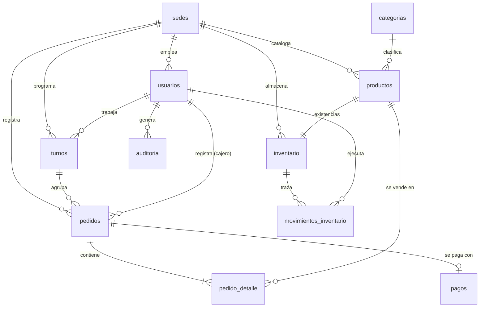

# Modelo relacional — Supermercado

Base de datos relacional única (MySQL 8, InnoDB, `utf8mb4`). Ver la justificación del
modelo relacional en la sección 11.2 del documento del proyecto. El esquema lo crea
GORM `AutoMigrate` al iniciar la API; `internal/database/schema.sql` es la referencia DDL.

## Tablas

### `sedes` — tiendas (RF-01)
| Columna | Tipo | Notas |
|---|---|---|
| id | PK | |
| nombre | VARCHAR(100) | único |
| direccion | VARCHAR(255) | |
| telefono | VARCHAR(30) | |
| color | VARCHAR(7) | color de la tienda en la interfaz |
| activa | BOOL | una tienda inactiva no opera (su personal no inicia sesión) |
| created_at | TIMESTAMP | |

### `usuarios` — personal (RF-02 / RF-10)
| Columna | Tipo | Notas |
|---|---|---|
| id | PK | |
| sede_id | FK sedes, NULL | NULL solo para el administrador general |
| username | VARCHAR(50) | único — identificador de inicio de sesión |
| nombre, email, documento, telefono | | datos básicos |
| fecha_ingreso | DATE | |
| password_hash | VARCHAR(255) | bcrypt cost 12 (RNF-01) |
| rol | ENUM | `admin`, `admin_tienda`, `cajero`, `auxiliar_bodega` (cargo) |
| activo | BOOL | estado; RN-12 |

### `categorias` — parámetro global
`id`, `nombre` (único), `descripcion`.

### `productos` — catálogo por tienda (RF-05)
| Columna | Tipo | Notas |
|---|---|---|
| id | PK | |
| sede_id | FK sedes | el producto pertenece a una tienda |
| codigo_barras | VARCHAR(50) | **único con sede_id** (RN-08) |
| categoria_id | FK categorias | |
| nombre, descripcion | | |
| unidad_medida | ENUM | `unidad`, `kg`, `g`, `l`, `ml`, `paquete` |
| costo_compra | DECIMAL(10,2) | menor que el precio |
| precio | DECIMAL(10,2) | > 0 (RN-07) |
| fecha_vencimiento | DATE NULL | vencido = no vendible (RN-03) |
| activo | BOOL | retiro lógico del catálogo |

### `inventario` — existencias
`id`, `sede_id`, `producto_id` (único compuesto), `stock_actual` (nunca negativo),
`stock_minimo` (umbral de alerta RN-11), `updated_at`.

### `movimientos_inventario` — trazabilidad
| Columna | Notas |
|---|---|
| inventario_id, usuario_id | qué existencia y quién |
| tipo | `entrada`, `descuento_venta`, `anulacion_venta`, `ajuste_averia`, `ajuste_devolucion`, `ajuste_vencimiento`, `ajuste_manual` |
| cantidad | con signo: + suma, − resta |
| stock_final | existencia resultante |
| pedido_id | venta relacionada (descuentos y anulaciones) |
| motivo, fecha | |

### `turnos` — RF-11
`id`, `sede_id`, `usuario_id`, `fecha`, `hora_inicio`, `hora_fin`, `estado`
(`programado` → `abierto` → `cerrado`), `asignado_por_id`, `abierto_at`, `cerrado_at`
y el resumen del cierre: `num_ventas`, `total_ventas`, `total_efectivo`, `total_debito`, `total_credito`.

### `pedidos` — ventas (CU-01)
| Columna | Notas |
|---|---|
| sede_id, usuario_id | tienda y cajero |
| turno_id | turno vigente del cajero (RN-09) |
| estado | `abierto` → `pagado` → `anulado` |
| created_at, cerrado_at | |
| anulado_por_id, anulado_at, motivo_anulacion | RN-10 |

### `pedido_detalle` — líneas de venta
`pedido_id`, `producto_id`, `cantidad`, `precio_unitario` (copia del precio al momento de la venta).

### `pagos`
`pedido_id` (único: un pago por venta), `usuario_id`, `total`, `metodo_pago`
(`efectivo`, `tarjeta_debito`, `tarjeta_credito`), `fecha`.

### `auditoria` — bitácora (RF-13)
`usuario_id`, `username`, `rol`, `sede_id`, `accion`, `entidad`, `entidad_id`,
`resultado` (`exito`, `denegado`, `fallido`), `detalle`, `metodo`, `ruta`, `ip`, `fecha`.
Solo inserción.

## Reglas reforzadas en la base de datos

| Regla | Mecanismo |
|---|---|
| RN-08 código único por tienda | índice único `uq_producto_sede_codigo (sede_id, codigo_barras)` |
| Un pago por venta | índice único en `pagos.pedido_id` |
| Una fila de inventario por producto y tienda | índice único `uq_inv_sede_producto` |
| Stock nunca negativo | `UPDATE … WHERE stock_actual >= cantidad` dentro de la transacción de venta |
| Dominios cerrados | columnas `ENUM` (roles, estados, tipos, unidades, medios de pago) |
